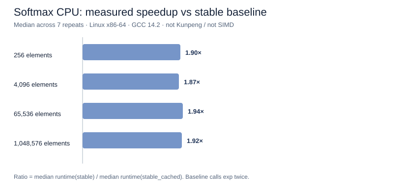

# Softmax CPU 性能测试与优化实践

**技术栈：C++17 · CMake · Python · Linux · GitHub Actions**

本项目是一个使用 AI 辅助开发的 **Softmax 算子实现与 CPU 性能分析实践项目**。围绕数值稳定性、重复指数计算与运行效率，使用 C++ 实现四种 Softmax 计算方法，并通过正确性测试、自动化基准测试和可复现的数据分析，比较不同实现的性能表现。

项目参考了 [Online normalizer calculation for softmax](https://arxiv.org/abs/1805.02867) 论文，并结合此前对 [Google Highway](https://github.com/google/highway) 的技术资料学习开展探索。

> **说明：** 当前项目**未使用** Google Highway、显式 SIMD 指令，也未实现 AI Agent。以下结果来自 **Linux x86-64 CPU**，并非华为鲲鹏处理器实测数据；项目的主要优化手段是缓存指数计算的中间结果。

## 1. 项目功能

项目实现并对比了四种 Softmax 方法：

| 实现名称 | 主要思路 | 数值稳定性 |
| --- | --- | --- |
| `naive` | 直接进行指数运算、求和与归一化 | 对较大输入可能溢出 |
| `stable` | 先减去最大值，再分别计算分母与输出 | 稳定 |
| `stable_cached` | 缓存指数计算结果，避免第二次重复计算指数函数 | 稳定 |
| `online` | 使用在线最大值与归一化因子更新方法 | 稳定 |

- **正确性验证：** 检查常规输入、随机数据、极端数值以及非法输入（空数组、NaN、无穷大等）。
- **性能评测：** 对多种输入规模重复测试，记录单次调用耗时，并使用中位数降低偶然波动的影响。
- **自动化分析：** 使用 Python 脚本完成编译、测试、基准测试和结果统计。
- **持续集成：** 使用 GitHub Actions 执行 C++ 测试和轻量级性能测试。

所有实现要求输入为**非空且元素有限的 `float` 数组**；中间求和使用 `double`，最终输出为 `float`。

## 2. 性能优化思路

Softmax 的计算公式为：

\[
\operatorname{Softmax}(x_i)=\frac{e^{x_i-m}}{\sum_j e^{x_j-m}},\qquad m=\max_j x_j
\]

减去最大值不会改变 Softmax 结果的数学定义，却能降低较大输入引起指数溢出的风险。

在本项目的普通稳定版本 `stable` 中，指数函数会在计算分母和生成输出时分别调用一次；`stable_cached` 则先将指数结果存入缓冲区，再使用缓存值归一化，从而减少重复计算。

这里比较的是**本项目中两种具体实现之间的差异**，不代表对 PyTorch、oneDNN 等成熟算子库的性能优势。

## 3. 性能测试结果

以下为一次 Linux x86-64 环境下的实测结果。每种实现重复测试 **7 次**，表中展示每次调用耗时的中位数。

| 输入元素数 | 普通稳定版 `stable` | 指数缓存版 `stable_cached` | 相对加速比 |
| ---: | ---: | ---: | ---: |
| 256 | 3.535 μs | 1.865 μs | 1.90× |
| 4,096 | 57.050 μs | 30.525 μs | **1.87×** |
| 65,536 | 976.676 μs | 503.903 μs | 1.94× |
| 1,048,576 | 15,571.607 μs | 8,107.152 μs | 1.92× |

**加速比 = `stable` 的耗时 / `stable_cached` 的耗时。** 该基准版本包含两次指数计算，并非经过高度优化的工业级实现。



- 原始测试记录：[`results/benchmarks.csv`](results/benchmarks.csv)
- 中位数及加速比：[`results/summary.csv`](results/summary.csv)
- 详细数据报告：[`results/summary.md`](results/summary.md)
- 运行环境：[`results/environment.json`](results/environment.json)

**测试说明：** 结果受 CPU、编译器版本、系统负载及内存分配等因素影响；缓存中间结果也会改变内存访问和浮点舍入行为。本项目没有实现 SIMD 加速，上述数字不能写成“SIMD 提速”或“鲲鹏平台提速”。使用不同机器运行时，应重新测试并以实际数据为准。

## 4. 本地运行

**运行要求：** C++17 编译器、CMake 3.16+、Python 3.8+。Python 脚本仅使用标准库，无需额外安装第三方 Python 包。

### 一键运行

Linux / macOS：

```bash
python3 scripts/run_experiment.py
```

Windows（安装了 Python 启动器时）：

```powershell
py -3 scripts/run_experiment.py
```

该脚本依次执行 Release 构建、正确性测试、性能测试及结果分析，生成 CSV 和 Markdown 报告。

### 手动构建与测试

```bash
cmake -S . -B build -DCMAKE_BUILD_TYPE=Release
cmake --build build --config Release
ctest --test-dir build --output-on-failure -C Release
```

### 自定义测试规模与重复次数

```bash
python3 scripts/run_experiment.py --sizes 128,2048 --repeats 3
```

## 5. 项目目录

```text
softmax-cpu-benchmark/
├── include/softmax.hpp           # Softmax 函数接口
├── src/softmax.cpp               # 四种 Softmax 实现
├── src/benchmark.cpp             # C++ 基准测试程序
├── tests/test_softmax.cpp        # 正确性与边界测试
├── scripts/run_experiment.py     # 自动构建、测试与统计
├── scripts/analyze_results.py    # 中位数、加速比计算
├── results/                     # 原始性能数据、汇总报告、环境信息
├── docs/benchmark.svg           # 实测性能对比图
├── .github/workflows/ci.yml     # GitHub Actions 持续集成
├── CMakeLists.txt
└── README.md
```

## 6. 项目收获与后续拓展

本项目重点实践了：

1. **数值稳定性：** 理解 Softmax 的指数溢出问题，以及减去最大值的处理方法。
2. **计算流程优化：** 通过缓存中间结果减少重复指数运算，分析运行时间的变化。
3. **性能测试方法：** 使用固定随机种子、重复测量和中位数统计，对比具体实现的执行效率。
4. **工程化组织：** 使用 CMake、CTest、Python 和 GitHub Actions 管理构建、测试与数据分析。

后续可进一步学习 **SIMD 向量化、Google Highway、Linux 性能分析工具**，并探索使用 AI Agent 辅助理解测试日志和生成优化建议。这些属于**后续方向**，不属于当前项目已经完成的功能。

## 7. 参考资料

- [Milakov & Gimelshein, *Online normalizer calculation for softmax*（2018）](https://arxiv.org/abs/1805.02867)
- [Google Highway — 可移植 SIMD/C++ 计算库](https://github.com/google/highway)（学习参考，当前项目未依赖该库）

项目采用 [MIT License](LICENSE) 开源。
